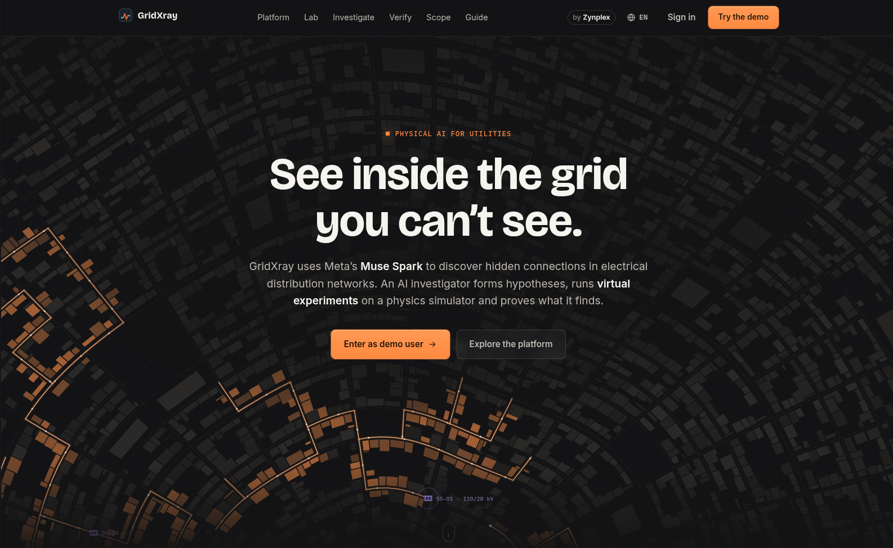
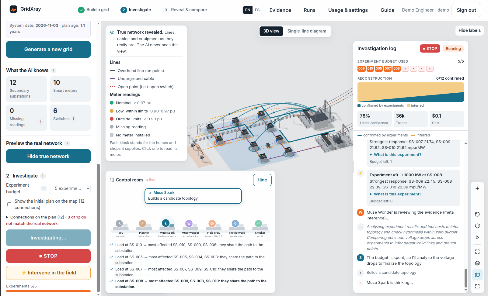
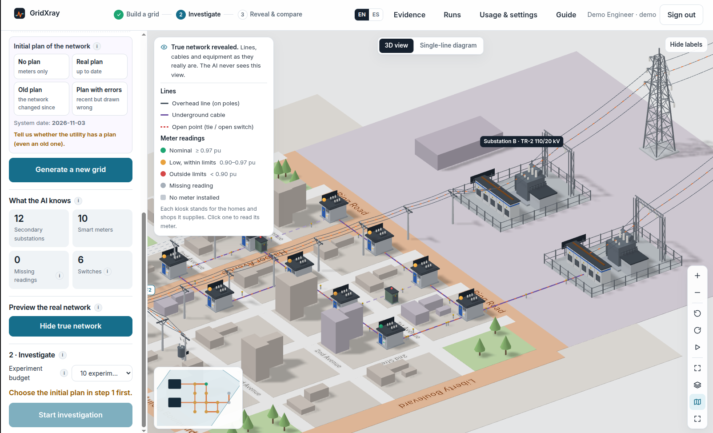
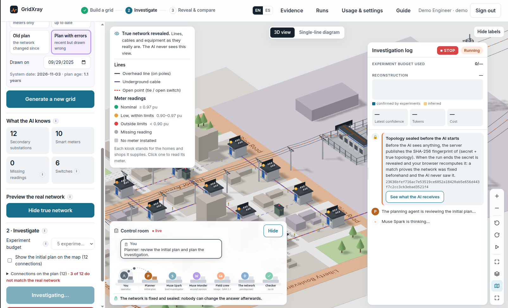
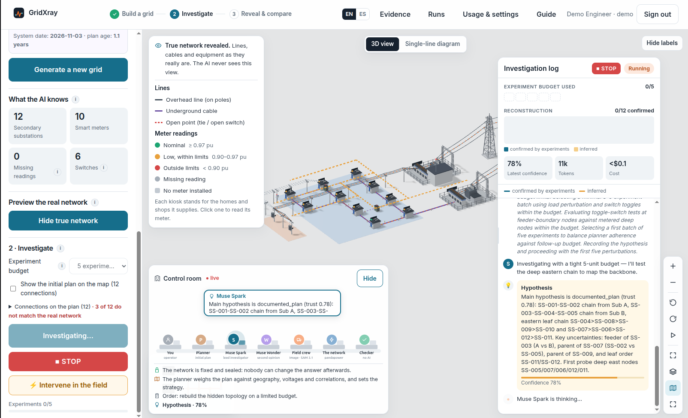
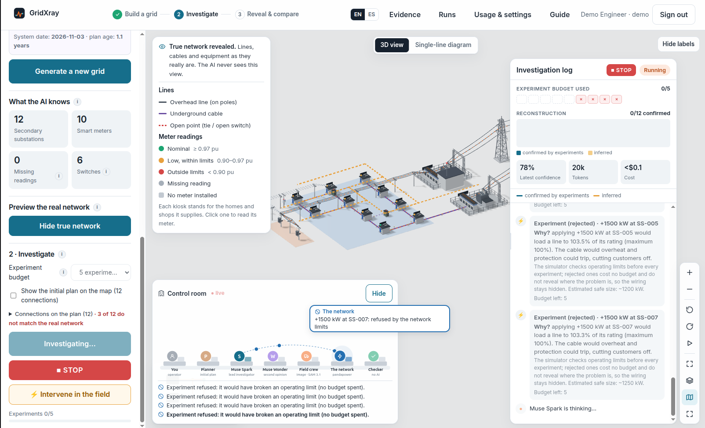
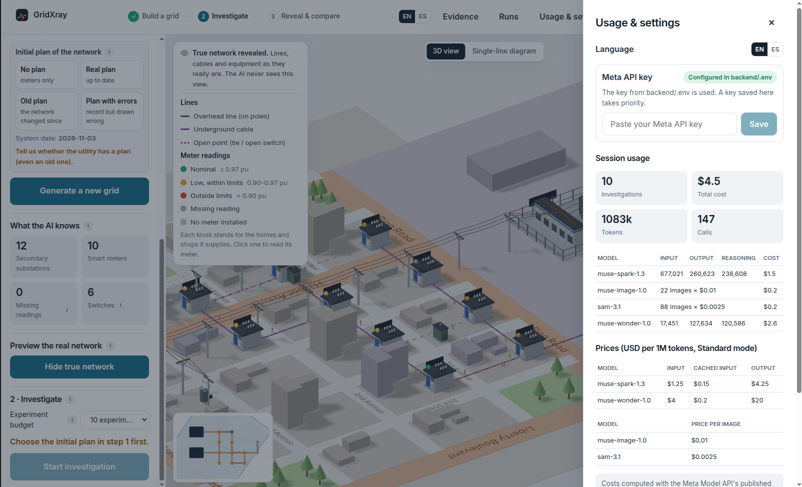

# GridXray — Physical AI for Utilities

**GridXray uses Meta's Muse models to discover the hidden wiring of electrical distribution networks by experimenting on them.**
An AI investigator reads the meters a utility already has, forms hypotheses about which secondary substation feeds which,
designs virtual experiments on a physics simulator to tell them apart, sends field crews to photograph switches, and
reconstructs the network: with every connection marked as measured, inferred or uncertain, and scored against the truth
by a checker with no AI in it.

**Meta Global AI Developer Hackathon 2026** · Track: Startup · Theme: Push the Frontier · by [Zynplex](https://zynplex.com)



## The problem

Distribution utilities do not know exactly how their medium-voltage networks are connected today. GIS records drift
from reality with every repair and every switching operation; switch positions are documented once and then changed in
the field; and the network is built meshed but operated radially through normally open ties, so the energized topology
is invisible from the map. Wrong topology means wrong fault location, unsafe switching orders, hosting-capacity studies
built on fiction and customers restored late.

Finding out is expensive: crews walking feeders, engineers operating switches one at a time. Every real experiment costs
time, risk and customer impact, so the question is not only *what is the topology* but **which experiment to run next**.
That decision is what GridXray hands to an AI, inside a simulator, before anyone touches the real network.

**Who benefits:** distribution planning and operations engineers (model validation before switching orders and
connection studies), GIS teams (finding outdated records), and field operations (crews sent only where a photo settles
what the meters cannot).

## What it does



1. **Observe.** The agent receives only what a utility knows: each secondary substation's city block, its smart-meter
   reading (noisy, sometimes missing, sometimes faulty), equipment, and the *documented* switch positions. Never the wiring.
   Optionally, the utility's initial plan (none, current, old or with errors), given blind: only the drawing and its dates.
2. **Plan.** A Planning agent weighs that plan against free checks (meter correlations, geography), decides how far to
   trust it and, in autonomous mode, sizes the experiment budget. The plan then votes in the ensemble by that trust.
3. **Experiment.** It designs load steps and switch operations, run on a real power-flow model (pandapower) within
   operating limits (0.90–1.10 pu, no overloads, no customers left without supply) and a budget. Unsafe experiments are
   refused with the limit they would break and a safe size to retry.
4. **Reason.** Muse Spark leads the investigation through tool calls. Its evidence is combined with traditional methods
   (24 h voltage-correlation clustering and a Chow-Liu tree, a GIS prior) and Muse Wonder's own inference into an
   ensemble that shows where methods agree and where they do not; Spark spends the budget on the disagreements.
5. **Verify in the field.** A crew visit produces a photo of the site (Muse Image), SAM 3.1 segments the equipment, and
   Muse Spark reads the switch position from the photo, flagging records that are outdated. When something fails in the
   field (a burnt meter, a de-energized site), the Planning agent re-plans: it may add experiments (capped), send a crew
   and say where to re-test.
6. **Conclude.** The result is a radial tree with each connection marked *measured*, *inferred* or *uncertain*, scored by
   an independent checker against the network sealed before the run.

| | |
|---|---|
|  |  |
| **The true network** (3D view). Lines, cables, kiosks and meter readings as they really are; the AI never sees this view. | **Sealed before the AI starts.** The SHA-256 commitment is published first; the Planning agent reviews the initial plan. |
|  |  |
| **Hypothesis.** Muse Spark states its main hypothesis, key uncertainties and which nodes to probe first. | **Safety first.** Experiments that would overload a line are refused, cost no budget and reveal nothing about the wiring. |

## How Meta models are used

| Model | Role | How |
|---|---|---|
| **Muse Spark 1.3** | Lead investigator | Tool-calling loop over the Responses API (state kept with `previous_response_id`): decides every experiment, interprets results, writes hypotheses, chooses when to send crews and when to stop |
| **Muse Spark (planner)** | Planning agent | Weighs the blind initial plan against free checks, sets its trust and the budget; re-plans after field failures |
| **Muse Wonder 1.0** | Second opinion and fourth method | Reviews the evidence when the investigation stalls, at mid-budget or before closing with many uncertain connections; separately infers the topology from the raw data as one vote in the ensemble (in a background thread, so Spark keeps experimenting) |
| **Muse Image 1.0** | Field photo | Draws the site the crew would see, from what is physically there in the simulator (including the switch's real position) |
| **SAM 3.1** | Segmentation | Finds the switch, transformer, insulators, cables and tags in the photo (masks decoded with `meta-sam-parser`) |
| **Muse Spark (vision)** | Photo reading | Reads the switch position from the photo and SAM's objects; the investigator receives only this reading, never the simulator's state |

Every call, token and cost is logged in the investigation's record and shown live (*Usage & settings*).



## Why the result can be trusted

- **The topology is sealed before the AI starts.** The server publishes `SHA-256(secret + true topology)` as the first
  event; when the run ends the secret is revealed and your browser recomputes the hash. A match proves the network was
  fixed beforehand. *See what the AI receives* shows the exact input and instructions.
- **The AI never sees the wiring.** Agents get an observable view and experiment results; tests check that the truth
  never leaks.
- **No AI in the score.** An independent checker compares the proposed connections with the simulator's truth
  (correct / real, F1, wrong connections and how many were honestly flagged uncertain).
- **Real physics.** Every experiment is a pandapower power flow, reverted afterwards and charged to the budget.
- **Reproducible.** Same seed, same network. 69 automated tests (results on the *Evidence* page).

## Results

Scored against the real network by the independent checker. Latest run: current version (planner, field crews and
re-planning included), real Muse Spark + Muse Wonder calls, Nov 1, 2026.

**Impact in one line:** on a 30-substation network with two feeders, a tie and 20% of substations unmetered,
GridXray recovers **63% of the real connections (57/90 across 3 networks) with 15 simulated experiments, ~7 minutes and
$0.74 per network**, without touching the real grid, and honestly flags **58% of its own mistakes (19/33)** as uncertain,
so crews are sent only to the connections the meters could not settle instead of walking all 30 sites.

**Benchmark (current version, Muse Spark + Muse Wonder, no initial plan):**

| Level | Runs | Budget | Real connections recovered | F1 | Wrong flagged as uncertain | Cost / run | Time / run |
|---|---|---|---|---|---|---|---|
| Easy (15 substations, every node metered) | 3 | 8 | **37/45 (82%)** | 82% | 4/8 | $0.60 | 6.4 min |
| Medium (30 substations, 2 feeders + tie, 80% metered, missing readings) | 3 | 15 | **57/90 (63%)** | 63% | 19/33 | $0.74 | 6.7 min |

Same seeds as the Oct 29 benchmark: medium is unchanged in accuracy and now flags more of its errors (16/33 → 19/33);
easy varied between runs (40/45 → 37/45), which is the run-to-run spread of the models on 15-substation networks.
One medium run hit a transient Meta API 503 and was repeated. Raw results: `backend/results/benchmark_current.json`.
Giving the AI a plan helps further: in calibration, the plan's vote added 4 to 9 points of ensemble accuracy.

**Interactive runs from the web app (final version: initial plan, Planning agent, field crews, live incidents).**
Every scored run made in the app since the Planning agent landed, none left out; budgets and plans as chosen in the app.

| Date | Network | Initial plan | Budget | Live incidents | Real connections recovered | F1 | Cost | Time |
|---|---|---|---|---|---|---|---|---|
| Nov 3 | Easy (15) | current | 10 | — | **15/15** | 100% | $0.44 | 5.7 min |
| Nov 3 | CIGRE MV benchmark (12) | with errors | 15 | yes, re-planned | **11/12** | 92% | $1.15 | 15.9 min |
| Nov 3 | Designed network (3) | with errors | 10 | yes, re-planned | **3/3** | 100% | $0.30 | 5.8 min |
| Nov 3 | Easy (15) | with errors | 6 | — | 11/15 | 73% | $0.82 | 11.8 min |
| Nov 3 | Hard (60) | with errors | 11 | yes, re-planned | 21/60 | 35% (36/39 wrong flagged uncertain) | $1.20 | 12.3 min |
| Oct 30 | Easy (15) | with errors | 22 | yes, re-planned | **14/15** | 93% | $0.66 | 6.8 min |
| Oct 30 | Designed network (4) | with errors | 5 | yes | **4/4** | 100% | $0.19 | 1.9 min |
| Oct 30 | Medium, partial (7) | none | 5 | yes | 4/7 | 62% | $0.59 | 5.3 min |
| Oct 29 | Medium (30) | old | 22 | — | **23/30** | 77% | $0.43 | 12.0 min |
| Oct 29 | Medium (30) | old | 10 | — | 17/30 | 57% | $0.82 | 6.6 min |
| Oct 29 | Designed network (4) | with errors | 5 | yes | **4/4** | 100% | $0.18 | 2.3 min |

On the published CIGRE MV benchmark GridXray recovered 11 of 12 connections while a wrong plan was given and the field
changed under it, and the one mistake was flagged as uncertain. With a current plan it reconstructs an easy network
perfectly; on hard 60-substation networks with a tiny budget it recovers a third and marks almost every error
(36 of 39) as uncertain instead of claiming it. Raw events and scores are stored with each run and every report is
printable from the app.

**Ablation (Oct 29): does Muse Wonder add anything?** Same seeds and budgets; "Spark alone" has no Wonder reviews and no
Wonder vote in the ensemble, everything else identical.

| Level | Spark alone | Spark + Wonder | Wrong connections | Cost / run |
|---|---|---|---|---|
| Easy | 37/45 (82%) | **40/45 (89%)** | 8 → 5 | $0.20 → $0.44 |
| Medium | 51/90 (57%) | **57/90 (63%)** | 39 → 33 | $0.17 → $0.74 |

Wonder's second opinion and its own inference raise accuracy on both levels (+7 and +6 points) and cut wrong
connections by a sixth to a third, at 2–4× the cost per run. On medium networks most remaining errors involve
secondary substations without a meter, which only inference can place; GridXray marks them as inferred instead of
claiming them. Field crews read the switch position correctly in 8 of 8 test visits, including 3 outdated records.
Raw results: `backend/results/ablation_*.json`; every run is listed on the *Evidence* page.

**Report of the run shown in the demo video:** [`docs/gridxray-investigation-report.pdf`](docs/gridxray-investigation-report.pdf).
Easy network (15 secondary substations), initial plan with errors given blind, two meter faults injected mid-run:
**14/15 connections recovered (F1 93%)**, both field incidents detected by the AI and re-planned around, two crew
visits (one photographed a burnt meter), sealed topology verified, **$0.66** in Meta model calls.

## Features

- **Workspace**: build a network (synthetic easy / medium / hard, the CIGRE MV benchmark, or your own), watch the
  investigation live in a 3D city view or a single-line diagram, stop it at any moment, resume after a restart.
- **The AI's network in the diagram**: measured connections in blue, inferred ones dashed; after *Reveal & compare*,
  correct in green, wrong in red and the real connections it missed, with an *AI's network / real network* switch.
- **Field crews**: an animated crew drives to the site; the photo, the SAM 3.1 segmentation and the reading appear in
  the log, with the exact prompt Muse Image received.
- **Design your own network**: place secondary substations on city blocks, join them with overhead lines or underground
  cables, add sectionalizers, reclosers, fuses and normally open ties, and choose each switch's real position and what
  the records say. The editor checks the design live (all supplied, radial, no loops) and can start from any generated
  network.
- **Live intervention**: while the AI investigates, operate switches (close a tie and open a sectionalizer to transfer
  load) or switch meters off. Unsafe operations are refused. The AI is not told: the experiment engine notices the change
  from the baseline readings (a statistical test against meter noise) and from repeated load steps, sets earlier
  experiments aside, and the agent re-tests the area. Each intervention publishes a new commitment; the run is scored
  against the network as it ended while the original seal still verifies.
- **Initial plan and Planning agent**: give the AI the utility's plan (none, current, old or with errors) without
  telling it which; the planner sets how far to trust it and, in autonomous mode, the budget. After *Reveal & compare*
  the plan's wrong connections are marked on the map.
- **Deliberate outages and field faults**: leave substations without supply or burn a meter; their readings go
  silent, the AI notices, crews can see the fault, the planner re-plans and de-energized areas are left out of the score.
- **Explained experiments**: every experiment says in plain words what was physically done and, when rejected, which
  limit it would have broken and by how much.
- **Report** per investigation (printable, with crew photos), **Evidence** page (benchmark, ablation, tests,
  guarantees), bilingual interface (English / Spanish).

## Quick start (Docker)

```bash
cp .env.example backend/.env      # then paste your Meta Model API key into it
docker compose up --build
```

- Web app: http://localhost:8080 → click **Enter as demo user**
- API docs: http://localhost:8000/docs

### Demo account

| Email | Password |
|---|---|
| `demo@gridxray.dev` | `gridxray-demo` |

Change them with `DEMO_USER_EMAIL` / `DEMO_USER_PASSWORD` in `backend/.env`. Sessions use an HttpOnly cookie signed with
`SECRET_KEY`; set your own outside local development. The shared demo account keeps each browser's runs and networks apart.

### Meta Model API key

1. Create a key in the [Meta Model API dashboard](https://dev.meta.ai/) ([docs](https://dev.meta.ai/docs/quickstart#api-key)).
2. Put it in `backend/.env` as `META_API_KEY=...` (`MODEL_API_KEY` also works), or paste it in the app under
   **Usage & settings**: it is checked with Meta, stored encrypted and takes priority over `backend/.env`.
3. Check access: `docker compose run --rm api gridxray ping`.

`backend/.env` is git-ignored. Scenario generation, the editor and the checker work without a key; investigations need one.

## Architecture

```
browser ──► web (nginx :8080) ──/api──► api (FastAPI :8000) ──► Meta Model API (Spark · Wonder · Image · SAM 3.1)
                                                         ├──► pandapower (in-process simulation)
                                                         └──► postgres (:5432, host :5433)
```

How one investigation flows between the agents and the simulator:

```
                ┌──────────── sealed topology (SHA-256) ────────────┐
                ▼                                                    │
 records + meters + blind plan ──► Planning agent (Muse Spark) ──► trust in the plan, budget
                                          │
                                          ▼
                      Investigator (Muse Spark, tool-calling loop) ◄──── second opinion: Muse Wonder
                       │            │               │                         ▲
             run_experiments   dispatch_crew    consensus ◄── ensemble: physics · 24 h correlation
                       │            │               │         (Chow-Liu) · geography · plan · Wonder inference
                       ▼            ▼               │
              pandapower power   Muse Image photo ──► SAM 3.1 ──► Spark vision reading
              flow (limits,      (what is physically at the site)
              budget, revert)
                       │
                       └── field failure detected ──► Planning agent re-plans (extra experiments, crew, re-test)
                                          │
                                          ▼
                        submit_result ──► independent checker (no AI) ──► score + seal revealed
```

Investigations run in background threads and stream Server-Sent Events; every event is stored as it happens, so a run
survives a restart and resumes from its log without repeating experiments.

```
gridxray/
├── docker-compose.yml        # postgres + api + web
├── backend/                  # Python 3.12 · FastAPI · pandapower
│   ├── src/gridxray/
│   │   ├── lab/              # network generator, CIGRE / Oberrhein, designed networks (custom.py), load profiles, meters
│   │   ├── sim/              # experiment engine: limits, budget, field interventions and change detection
│   │   ├── tools/            # what the agents can call (observable view only), reconstruction, ensemble
│   │   ├── agent/            # Meta Model API client, Spark loop, Wonder review and inference, prompts
│   │   ├── field.py          # crew visits: photo prompt, SAM 3.1 parsing, photo reading
│   │   ├── verify/           # independent checker, benchmark and ablation
│   │   ├── seal.py           # topology commitment
│   │   ├── runs.py           # background runs, resume, interventions
│   │   ├── api/              # REST + SSE: investigations, networks, settings, auth
│   │   └── store/            # Postgres models
│   ├── results/              # benchmark, ablation and test results shown on the Evidence page
│   └── tests/
└── frontend/                 # React · TypeScript · Vite · three.js (React Three Fiber)
    └── src/                  # workspace, 3D scene, single-line diagram, editor, live log, evidence
```

## Development

```bash
docker compose up -d postgres                       # database on localhost:5433
cd backend && uv sync && uv run pytest               # tests use SQLite, no Postgres needed
uv run uvicorn gridxray.api.main:app --reload        # http://localhost:8000
cd ../frontend && npm install && npm run dev         # http://localhost:5173
```

CLI (from `backend/`):

```bash
uv run gridxray ping                                                 # check Meta Model API access
uv run gridxray investigate --level easy --seed 1 --budget 8 --log run.json
uv run gridxray benchmark --plan easy:1-3:8,medium:1-3:15 --out results/ablation_wonder.json
uv run gridxray benchmark --plan easy:1-3:8,medium:1-3:15 --out results/ablation_spark.json --no-wonder   # Spark only
uv run gridxray evidence                                              # run the tests for the Evidence page
```

## Roadmap: parallel coordinated agents

Today one Muse Spark investigator runs experiments one batch at a time, so a 30-substation network takes ~7 minutes and
larger feeders scale with the number of experiments. The next step is **several investigator agents working in
parallel, coordinated by the Planning agent**:

- The planner splits the network into areas that are electrically independent (different feeders, or sides of an open
  tie) and assigns one investigator per area, each with its own share of the budget.
- Experiments in independent areas run concurrently on copies of the power-flow model; experiments that touch shared
  equipment (ties, the primary substation) go through the coordinator, which serializes them so no two agents disturb
  the same readings.
- The coordinator merges each area's evidence into the shared ensemble, moves budget to the areas that are still
  uncertain, and decides when crews are worth sending.
- Muse Wonder keeps its role as the cross-area reviewer, checking the seams where areas meet.

The goal is wall-clock time that grows with the size of the largest area rather than the whole network, without
weakening the operating limits or the independent scoring.

## Honest limits

- Everything runs in simulation: no real grids, sensors or SCADA. Networks are synthetic or published benchmarks.
- Field photos are generated from the simulator's state, so they are as truthful as the simulator; their value here is
  showing the full loop (photo → segmentation → reading → record check), not replacing a real camera.
- Nodes without a meter can only be placed by inference; GridXray marks them as such instead of guessing silently.
- On very small or lightly loaded networks a field change barely moves the voltages; detection then relies on a
  repeated experiment.

## Built during the hackathon

All code in this repository was written during the event (Oct 26 – Nov 4, 2026); see the git history: scenario
generator, experiment engine, agent tools and loop, field crews, network editor, live intervention, checker, seal,
API and web UI.

### Hackathon log

- **Day 1 (Oct 27)** — Project base and Meta Model API access; scenario generator (synthetic, CIGRE MV, MV Oberrhein);
  experiment engine with operating limits; agent tools; Muse Spark investigation loop with Muse Wonder reviews;
  independent checker; hybrid ensemble (physics, 24 h correlations, geography, Wonder's inference); sealed topology
  verified in the browser; live investigations over SSE; 3D city view; Evidence page; faster runs and an immediate STOP;
  explained experiments; Meta API key in the app.
- **Day 2 (Oct 28)** — Field crews: a Muse Image photo of the site, SAM 3.1 segmentation and a Muse Spark reading of the
  switch position in every investigation, with outdated records flagged; animated crew in the 3D view.
- **Day 3 (Oct 29)** — Network editor (design your own network, switches with real and recorded positions); live field
  intervention with change detection by the experiment engine (no false alarms on unchanged networks); interventions
  visible in the scene and in the report; the AI's network in the single-line diagram (measured, inferred, correct,
  wrong, missed); control room with the agents at work and a control center sending each experiment's signals;
  nameplates and hover-only labels; per-image costs in usage; ablation Spark alone vs Spark + Wonder; full README.
  Later the same day: the utility's initial plan (none, current, old or with errors), given to the AI blind (only the
  drawing and its dates, never its kind); a Planning agent that weighs the plan against free checks, sets how far to
  trust it and, in autonomous mode, sizes the experiment budget; the plan joins the ensemble vote by trust; wrong plan
  connections marked on the map once the network is revealed. After a field failure the planner re-plans: it may add
  experiments (capped), recommend a crew and set where to re-test. Crews can see field faults (burnt meters,
  de-energized sites). Deliberate outages: substations left without supply go silent, cannot be tested and are left
  out of the score. The field panel says which switches cannot be operated alone and offers the tie that makes it
  possible; compact scene chips with the full text on hover; budget bar follows the planner's extensions; a resumable
  live stream; a link to the Meta Model API console for the real bill.
- **Days 4–8 (Oct 30 – Nov 3)** — Fresh benchmark of the final version with real Muse Spark + Muse Wonder runs and a
  one-line impact figure; printable report polished (crew visit notes and faults laid out cleanly); README completed
  (architecture, agent flow, roadmap).

## Third-party

| Component | License | Use |
|---|---|---|
| [pandapower](https://www.pandapower.org/) | BSD-3-Clause | Power-flow simulation; standard cable and transformer types; CIGRE MV and MV Oberrhein networks |
| FastAPI, Pydantic, SQLAlchemy, psycopg, sse-starlette, PyJWT, argon2-cffi, cryptography, OpenAI SDK, NumPy, numba, Pillow | MIT / BSD / Apache-2.0 / LGPL-3.0 / HPND | Backend |
| meta-sam-parser | see package | Decoding SAM 3.1 masks |
| PostgreSQL 18 | PostgreSQL License | Database (container) |
| React, Vite, three.js, React Three Fiber, drei | MIT | Frontend, 3D view |
| Meta Muse Spark, Muse Wonder, Muse Image, SAM 3.1 (Meta Model API) | Meta terms | Investigator, reviewer and inference, field photos, segmentation |

All grid data is synthetic, generated by this project or taken from pandapower's published benchmarks.
